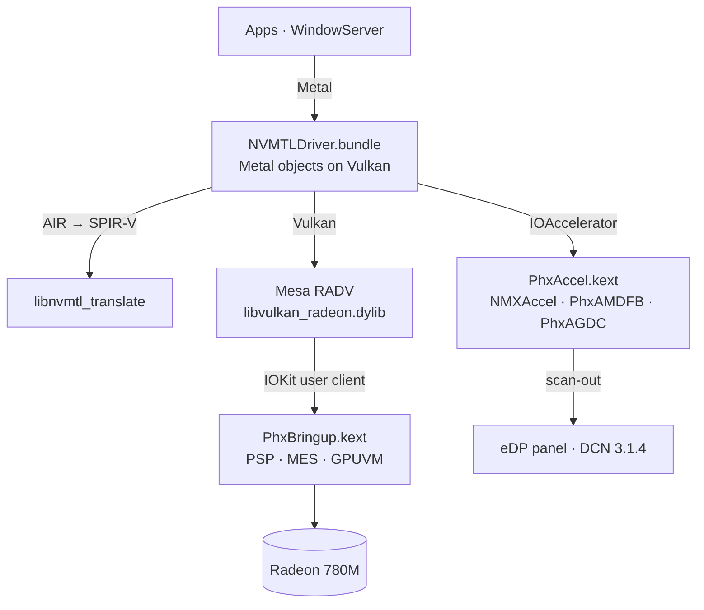

<p align="center">
  <picture>
    <source media="(prefers-color-scheme: dark)" srcset="assets/brand/nullarc-logo-dark.svg">
    
  </picture>
</p>

<p align="center">
  <b>Metal on AMD Radeon 780M (soon also Radeon 740M and 760M) for macOS Tahoe.</b><br>
  GPU bring-up, a display driver WindowServer composites on, and Metal over Vulkan (Mesa RADV)<br>
  for Phoenix / Hawk Point APUs (RDNA 3, GC 11.0.1, gfx1103).
</p>

<p align="center">
  
  
  
  <a href="https://github.com/luuumi-dev/nullarc/actions/workflows/ci.yml"></a>
  <a href="LICENSE"></a>
</p>

<p align="center"><b>English</b> · <a href="README_RU.md">Русский</a></p>

---

## Radeon 760M fork status

This fork adds the supplied HP Envy x360 16-ad0013dx capture (`1002:1900`, revision
`ca`, subsystem `103c:8c6a`): 8 active CUs with physical masks `[0x0f, 0x0f]`, six
physical CU slots per shader array, and enabled RB mask `0x0a`. Captured topology
is validated and transported to RADV through a versioned kernel query.

The source build pipeline now assembles PhxBringup, PhxAccel, this fork's Metal
plugin, the pinned LGPL translator and patched RADV. Authored Metal compute,
vertex and fragment shaders pass through the real metallib/AIR reader and
translator, validate as SPIR-V, and compile into gfx1103 pipelines with both 8-CU
HP and 12-CU legacy mocks. No GPU command execution is implied by those tests.

The kernel now rejects unready/wrong-engine submission, rolls back partial page
mappings, tracks multiple user fences, and retains memory after a device-loss
fault instead of freeing pages potentially referenced by DMA. Firmware tools
propagate transfer/status errors rather than reporting success after failure.
MES timeouts and failed compute/graphics readback now stop before queue adoption.

**Native GPU and Metal compute/render execution is now verified on this HP running
Sequoia 15.8.2, with PhxBringup build 39 and the matching PhxAccel.** The local-admin
hardware experiment successfully claimed measured VRAM leases, obtained the PSP's
64 MiB TMR requirement, loaded all 17 engine-firmware payloads, acknowledged GART
invalidation and MES commands, adopted compute/graphics queues after actual kernel
fences, and started NMXAccel. The native Darwin RADV path returned 256/256 correct
compute values, a translated Metal store returned 7, and translated offscreen
rendering returned 256/256 matching pixels.

The public Metal API also passed on the actual NVMTL device: 4096/4096 computed
values, completed command buffers without errors, and a 256×256 offscreen
triangle/clear render with 32,640 red pixels, 32,896 blue pixels and no other
pixels. A repeated test using `mtlprobe --hp` verified all five PCI identity
fields through the Metal device's registry ancestry and allowed no GPU fallback.
The same probe rejects mock transport and refuses the development Mac's RX 5700 XT.
See the [native execution report](hardware/dumps/hp_envy_760m/sequoia-build39-native-execution.json)
and [Metal execution report](hardware/dumps/hp_envy_760m/sequoia-build39-metal-execution.json).

These results establish basic compute and offscreen graphics acceleration through
NullArc's kernel, Darwin RADV, translator and Metal plugin. **WindowServer/panel
acceleration, GPU reset, suspend/resume and broad
application compatibility remain unverified or unimplemented.** The firmware
framebuffer still drives the panel. HP boot remains diagnostic until the explicit
administrator experiment or opt-in `--hp-native` app-only service. Automatic native
initialization, GUI-session Metal readbacks and app activation passed a fresh boot;
see the [cold-boot evidence](hardware/dumps/hp_envy_760m/sequoia-build39-automatic-app-activation.json).
The new display module (633BB085) now also passes native/Metal execution and the
HP console-plan/runtime ABI checks. The first actual display boot attached PhxAMDFB
and passed native tests, but WindowServer crashed: library validation rejected the
ad-hoc Metal plugin in the platform process. The one-shot fallback restored the
firmware framebuffer; display activation is disabled. AMFIPass 1.3.1 was loaded
but had no active service and declares Darwin 22 as its maximum; the HP is Darwin
24. A backed-up, explicitly authorized update to OCLP's AMFIPass 1.4.1 now loads
and publishes its active service after a dependency-only reboot, with boot arguments
unchanged. That active dependency alone still failed the same WindowServer
library-validation check. The user then authorized the upstream NullArc AMFI
boot options: both `amfi=0x80` and `amfi_get_out_of_my_way=0x1`, plus its beta/debug
options. These now boot on the HP, and an authored hardened loader can load the
actual Metal plugin without GPU commands. The next actual display boot loaded
NVMTL inside WindowServer and created its AMD Metal device. The user saw a partial
login UI with missing cursor/text; native and GUI Metal compute/render tests passed,
but the supervisor requested fallback when the console user changed. No successful
presentation-counter check or complete desktop is verified. Logs identify invalid
linear texture pitches, allocation failures and disabled framebuffer fetch.
See the [partial-display report](hardware/dumps/hp_envy_760m/sequoia-display42-partial-ui.json).
The [module test report](hardware/dumps/hp_envy_760m/sequoia-display40-metal-execution.json)
records those actual GPU readbacks.

The new Sequoia `install.sh --windowserver` path first stages the display module
for an **app-only validation reboot**. Only after that module's loaded UUID,
runtime family sizes/versions, captured console plan and current-boot app tests
pass can the same command arm one display boot. New preflight also requires the
reviewed Sequoia-compatible AMFIPass version, active service and the authorized
upstream AMFI arguments in the actual boot; these checks do not prove that
WindowServer can load the plugin. New crash monitoring
stops the experiment on a fresh current-boot WindowServer report. This experimental
display path is **not confirmed functional**. See
[installation stages](docs/INSTALL.md#hp-experimental-windowserver-stages). Do not
rerun the bootstrap in a boot with initialized or lost queues.

The Sequoia build uses `--min-macos 15.0`; build headers still require SDK 26.
Earlier CPU-only translation/compiler validation and Linux stock-RADV results
remain useful independent checks, but the reports above are the first native
macOS hardware evidence. Existing Firebat runtime claims below are retained as
upstream reports. Historical development milestones follow. The first automatic
boot also passed native PSP/MES and compute/render tests, then failed an immediate
Metal-device enumeration with an empty catalogue. The bounded system-context wait also timed out on a second boot, with native
GPU tests still passing. The latest service verifies Metal in the logged-in
console user’s GUI context after privileged native initialization; that corrected
startup path subsequently passed a fresh cold boot. The third boot kept healthy native queues and passed subsequent SSH Metal
compute/render tests without reinitialization. PhxAccel's 60-second withholding
of `MetalPluginName` was then identified; startup now waits for the actual
property before entering Metal. A verification-only continuation can finish app
activation without another reboot. Both that continuation and automatic app
activation on boot `49800A69-CF26-4E40-91FC-F09883D6268F` passed.

Development build 35 adds read-only memory snapshot selector 31 and `mesboot layout`.
The tool gets MC/physical addresses from the kernel, validates the reply and rejects
initialization when the remaining Firebat default-page plan does not match. Queue,
VRAM and doorbell accesses now reject overflow and queue-buffer overlap. These
changes build and pass host tests; the memory query now works on HP build 36.
The changes are not in the existing 0.1.1 release. Decoded memory does not establish ownership.

Build 36 additionally reads the matching cached ACPI VFCT/ATOM image and exports
supported firmware reservation metadata. The decoder checks checksums, PCI BDF,
table bounds and exact known formats; missing/unknown data stays explicit. It
does not execute VBIOS functions or enable HP hardware writes. Native compilation
and parser tests pass. HP build 36 booted but reported an unsupported ATOM format;
it did not establish reservations. Build 37 records the actual header versions
and adds a root-only cached VBIOS snapshot (`phxprofile --dump-vbios NEW_FILE`)
for inspecting that format. The HP capture succeeded: ROM 2.3/master 2.1,
firmware-info 3.4, and 2 MiB extra firmware reservation metadata. Build 38
supports the measured header and tests a redacted metadata fixture; the private
ROM is not distributed. A root-only `phxprofile --scanout` capture also succeeded
on running build 37 without another reboot (48 documented DCN registers, two
matching samples). These snapshots do not establish complete VRAM ownership.

Build 38 also fixes PSP TMR request truncation and false success tracking,
quarantines command/staging buffers after timeouts until acknowledged ring
destruction, and exposes the documented LOAD_TOC TMR-size reply through
`phxctl toc BYTES` after explicit staging. These PSP changes are compiled and
host-tested, not hardware-tested. The HP diagnostic restriction is preserved.
The complete Sequoia stack builds; HP memory ownership, firmware/queue
initialization, native GPU command execution and acceleration remain unfinished.

Build 39 adds an explicit experimental HP engine path. It compares live display,
cursor and DMCUB configuration with the captured Sequoia reservation profile,
requires the PCI provider's exclusive open, and leases nonoverlapping PSP,
firmware, MES and TMR regions. TMR size comes from LOAD_TOC (the HP Linux driver
reports 64 MiB), with no 16 MiB clamp or copied Linux allocation address. GART
scratch/fault pages are owned allocations. Firmware acknowledgements and kernel
RELEASE_MEM probes gate autoload and queue readiness. Native compute and
translated-render probes reject mock transport. The accelerator's HP gate now
requires a positive native claim. Default boot remains diagnostic; the new path
requires local administrator execution and is not yet runtime-verified. No Metal
or accelerated display success is claimed by this build.

See [development status](docs/760M_STATUS.md), [source dependency map](docs/760M_ARCHITECTURE.md),
and [build, package, offline translation tests and diagnostic installation](docs/BUILD_STACK.md).
Validate the supplied profile with `python3 tools/phx_profile.py --check`.
Mesa uses Phoenix patches 0001..0009; generator scripts are alternatives to applying
the corresponding patches, not additional steps.

## Status

Measured on the reference machine — Firebat U6C, Ryzen 7 H 255, Radeon 780M, 2560×1600 120 Hz eDP, macOS Tahoe 26.6.2 —
in October 2026:

| | |
|---|---|
| **Desktop** | WindowServer composites on the 780M at the panel's 120 Hz. CoreAnimation runs at 119–120 fps; dragging a window, 116 fps. |
| **Liquid Glass** | Dock, widgets, Control Center and in-app glass are drawn by the GPU with Apple's own compositor shaders (translated). |
| **Metal in apps** | Every process gets the Metal device, sandboxed WebKit GPU processes included. About 46 apps checked with no crashes, Safari, Chess and Spotify among them. |
| **Display sleep / wake** | Works. |
| **First use of a new effect** | A one-time pause of about 1–3 s while its shader is translated and compiled. After that it comes from the disk cache. |
| **Not yet** | External displays (HDMI, USB-C), hardware video decode/encode, backlight control. |

Other Radeon 780M / 760M machines (Phoenix, Hawk Point) are untested.

## How it works



| Component | Installed in | Source | Role |
|---|---|---|---|
| `PhxBringup.kext` | OpenCore `EFI/OC/Kexts` | [`src/phxbringup`](src/phxbringup) | Loads firmware through the PSP, powers up GFX (SMU/IMU), starts the MES scheduler and the compute and graphics queues, gives every process its own GPUVM address space, implements the BO/submit ABI RADV uses. |
| `PhxAccel.kext` | Auxiliary kernel collection | [`src/phxaccel`](src/phxaccel) | `NMXAccel` IOAccelerator, the `PhxAMDFB` framebuffer (VRAM pool, 120 Hz vblank, frame copy to scan-out) and `PhxAGDC` display control. |
| `NVMTLDriver.bundle` | `/System/Library/CoreServices/CoreTypes.bundle/Contents/Library/PhxGPU`, linked from `/Library/GPUBundles` | [`src/nmplugin`](src/nmplugin) | The Metal driver plugin: Metal on Vulkan, zero-copy IOSurfaces, shader caches. |
| `libvulkan_radeon.dylib` | `PhxGPU/nvmtl` | Mesa + [`mesa-patches-phoenix`](mesa-patches-phoenix) | RADV for gfx1103 with a Darwin winsys. |
| `phxboot` | LaunchDaemon `local.phxboot` | [`tools/phxctl/phxboot.sh`](tools/phxctl/phxboot.sh) | Brings the GPU up at boot before WindowServer opens the panel, with fail-safes that fall back to the firmware framebuffer. |

`libnvmtl_translate.dylib` (Metal AIR → SPIR-V, LGPL-3.0, based on metal2vulkan) ships prebuilt with NullMoth's
plugin; its source is attached to every release. The `NVMTL` prefix is NullMoth's too: none of this is an NVIDIA driver.

## Installing

Download the **compiled ZIP asset** from this fork's
[alpha release](https://github.com/yt42c2mvn2-cmd/nullarc-760m/releases/tag/alpha),
choose the Sequoia-labelled ZIP for macOS 15, verify `SHA256SUMS`, extract it, and follow **[docs/INSTALL.md](docs/INSTALL.md)**.
GitHub's automatic “Source code” downloads are not binary installer packages.

For the HP 760M, the supported development flow is:

```sh
./install.sh --diagnostics --oc /Volumes/EFI/EFI/OC --check
sudo ./install.sh --diagnostics --oc /Volumes/EFI/EFI/OC
```

Use the actual EFI/OC path for your machine. The release also contains
`sudo ./install.sh --windowserver` for the reference acceleration flow, but the
HP remains diagnostic-only and that command refuses acceleration before writing.
Python 3 is required. Diagnostic installation preserves boot/security settings.

The original Firebat installation/security instructions are retained in
[the archived reference guide](docs/INSTALL_REFERENCE.md). Its relaxed AMFI/SIP
settings and reported second-boot WindowServer acceleration apply to that
reference workflow; they are not HP diagnostic-install requirements.

## Building

On the Mac (Command Line Tools, [MacKernelSDK](https://github.com/acidanthera/MacKernelSDK)):

```sh
sh src/phxbringup/build.sh /path/to/MacKernelSDK      # PhxBringup.kext
sh src/phxaccel/build.sh /path/to/MacKernelSDK        # PhxAccel.kext
```

The plugin builds with `bash src/nmplugin/build.sh /path/to/Vulkan-Headers` from
`src/nmplugin/NVMTLDevice.m`, which includes the rest of `src/nmplugin`. RADV: Mesa
`f5cb8ee0` + Cobalt64's Darwin patches + [`mesa-patches-phoenix`](mesa-patches-phoenix/README.txt).

Unit tests (firmware parsing, IP discovery) run on Linux or macOS and in CI:

```sh
make fixtures   # Phoenix firmware from linux-firmware
make test
```

## Notable fixes

- **Zero-copy IOSurfaces** — textures are linear images over the surface's own pages; WindowServer CPU 77 % → 36 %.
- **Surface keep cache** — CoreAnimation re-wraps the same IOSurfaces every frame; keeping their imports took a dragged window from 64–69 to 116 fps.
- **VRAM pool** — per-allocation contiguous memory fragmented after hours and display wake froze; one 512 MB pool now.
- **RADV mutable descriptor lists** — indexed by the sorted binding order instead of the original one; broke CoreImage blurs and Tahoe's layered icons.
- **Nested loop unrolling (Mesa 0006)** — a new compositor shader variant compiled ~2 s in RADV, one loop level per optimisation round; now ~1 s with identical code.

## The name

**null + arc**: the empty-set sign of a driver that did not exist, its ring opened into an arc.
See the [brand guide](assets/brand/README.md).

## License and credits

Several licenses apply; see [LICENSE](LICENSE), [THIRD_PARTY_NOTICES.md](THIRD_PARTY_NOTICES.md) and [LICENSES/](LICENSES).

- Code written for nullarc (`src/phxbringup`, `tools/phxctl`, …): MIT, or GPL-2.0-only at your option.
- `src/phxaccel`, `src/nmplugin`, `tools/nvmtl-patches`: derived from NullMoth's macOS driver, **PolyForm Noncommercial 1.0.0** — no commercial use.
- `mesa-patches-phoenix`: MIT, as Mesa. Release packages also carry LGPL-3.0 (shader translator), LLVM and AMD firmware; see the notices.

Built on the work of the Linux `amdgpu` team, Mesa, NullMoth, [Cobalt64](https://cobalt64.com),
[Acidanthera](https://github.com/acidanthera) and the AMD-OSX community.
